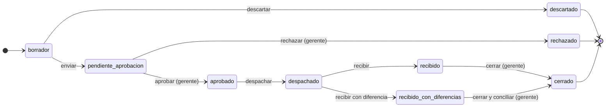

# Lógica del backend — Soriega DSS

Actualizado al 11/11/2026. Versión editable: [Claude Docs](https://claude.ai/artifact/B5GtZRLqkFx2M3RAaiG18s).

## Versión resumida

El backend convierte los reportes que exporta el sistema administrativo de Soriega en decisiones: qué mercancía mover entre el almacén y las tiendas, qué productos están por agotarse y qué capital está inmovilizado.

**Qué hace, en cinco pasos**

1. **Recibe los datos.** Un administrador sube los reportes de ventas, inventario de cada sucursal, inventario del almacén y tasas cambiarias (Excel o CSV). Cada carga reemplaza la anterior de esa sucursal y queda registrada.
2. **Calcula las ventas reales.** Convierte cada venta en bolívares a dólares con la tasa interna del día y separa lo que no es venta comercial (reposiciones entre tiendas, mermas, consumo interno, servicios).
3. **Mide la demanda.** Con las ventas calcula cuánto se vende por día de cada artículo, lo clasifica en A, B o C según las unidades que vende y estima cuántos días de stock le quedan en cada tienda (cobertura).
4. **Propone y controla traslados.** Sugiere qué enviar del almacén a cada tienda y lo agrupa en documentos con folio (TR-00001). Cada documento pasa por aprobación, despacho y recepción, y cada paso queda en su historial.
5. **Resume lo urgente.** El Centro de decisiones muestra las ventas del mes, los traslados pendientes, los productos críticos y el capital estancado.

**Reglas que conviene conocer**

- Solo un gerente puede aprobar, rechazar o cerrar un traslado.
- Una recepción con cantidades distintas a las despachadas queda como discrepancia hasta que un gerente la revise.
- Un producto es crítico cuando es clase A o B y le quedan menos de 7 días de cobertura.
- El capital estancado es el valor de los artículos con stock que no se venden desde hace un umbral de días (90 por defecto).
- Las ventas del mes se comparan con los mismos días del mes anterior, para no comparar un mes a medias con uno completo.

**Límite actual:** el backend aún no verifica la identidad de quien llama; confía en el usuario y el rol que envía el navegador (ver [Pruebas y limitaciones](#pruebas-y-limitaciones)).

## Arquitectura

El backend es una aplicación Flask con arquitectura hexagonal: las reglas de negocio no conocen Flask, SQLAlchemy ni pandas, y dependen solo de interfaces. Las dependencias apuntan siempre hacia el dominio.

| Capa | Carpeta | Responsabilidad | Depende de |
| --- | --- | --- | --- |
| Dominio | `dominio/` | Reglas puras: estados de traslados, demanda, ABC, ventas, lectura de reportes, errores | Nada externo |
| Aplicación | `aplicacion/` | Casos de uso que orquestan el dominio y los repositorios (`CasosTraslados`, `CasosVentas`, …) | Dominio y puertos |
| Puertos | `puertos/` | Interfaces `Protocol` que la aplicación necesita (`RepositorioVentas`, `LectorReportes`, …) | Nada externo |
| Entrada | `adaptadores/entrada/` | Blueprints Flask bajo `/api`: leen la petición, llaman al caso de uso y serializan a JSON | Aplicación |
| Salida | `adaptadores/salida/` | Implementan los puertos: repositorios SQLAlchemy, lector pandas, modelos y migraciones | Puertos, ORM |
| Composición | `app.py` | Configura Flask, crea los adaptadores y los inyecta en los casos de uso | Todo |

**Por qué así.** El dominio se prueba sin base de datos (los tests `test_dominio_*` usan objetos simples) y un cambio de base de datos o de lector de archivos solo toca los adaptadores de salida.

**Errores.** El dominio lanza `ErrorDominio` y sus subclases; la entrada las traduce a HTTP: `Prohibido` → 403, `NoEncontrado` → 404, `Conflicto` → 409 y el resto → 400 (`adaptadores/entrada/http.py`). Toda respuesta es JSON con `success` y, si falla, `error`.

**Arranque.** `python app.py` crea las tablas que falten (`db.create_all()`), aplica las migraciones de columnas (`migrar_esquema`) y escucha en `127.0.0.1:5000`. La conexión sale de `DATABASE_URL` (PostgreSQL).

## Carga de datos

Cada reporte que se sube es una foto completa: reemplaza los datos anteriores de su tipo y sucursal en una sola transacción, y la carga queda registrada aunque falle.

**Ruta:** `POST /api/carga_inicial` (multipart: `archivo`, `tipo_reporte`, `sucursal`). Límite de 25 MB por archivo.

| `tipo_reporte` | Reporte | Pide sucursal | Qué reemplaza |
| --- | --- | --- | --- |
| `ventas` | Artículos vendidos | Sí | Todas las ventas de esa sucursal (y las antiguas sin sucursal); guarda la tasa BCV de cada día (columna FACTOR) |
| `inv_fisico` | Inventario de sucursal (INV) | Sí | El inventario de esa sucursal |
| `inv_inval` | Inventario del Almacén Principal (INVAL) | No | El inventario del almacén |
| `tasas` | Hoja TASA del libro de pedidos | No | La tasa interna de las fechas que trae (no borra las demás) |

**Lectura** (`adaptadores/salida/lector_pandas.py`). Acepta .xlsx, .xls y .csv; el formato real se detecta por el contenido, porque el sistema exporta .XLS que son .xlsx. Busca la fila de encabezados en las primeras 5 filas (los reportes traen un título antes) y exige al menos una columna de cada grupo requerido, por ejemplo código y fecha de emisión para ventas. Un CSV que no es UTF-8 se reintenta en latin-1.

**Interpretación** (`dominio/importacion.py`):

- **Artículos internos:** los del grupo MARKETING o subgrupo EQUIPOS DE OFICINA se ignoran en toda la lógica y se eliminan si ya estaban guardados.
- **Códigos:** se normalizan quitando el `.0` que agrega Excel (`12345.0` → `12345`).
- **Facturación en Bs:** `PRECIOFIN × 1,16 (IVA) × cantidad neta`, donde cantidad neta = cantidad − devueltas. El USD se calcula al consultar (ver [Ventas y tasas](#ventas-y-tasas)). Si el archivo ya trae la columna `fact`, se usa tal cual.
- **Costo:** la columna `costo` si existe; si no, `COSTOEX × 1,16 × cantidad neta`.
- **Excepciones:** cada venta se marca con su excepción (reposición, merma, consumo interno, servicio) por igualdad exacta con el cliente, el grupo o el nombre.
- **Precio de venta en USD:** las sucursales lo traen en `PRECIO1EX`; el almacén, en `PRECIO1`.
- **Sucursal:** el nombre se canoniza contra las ya registradas sin distinguir mayúsculas ni acentos ("MATURIN" → "Maturín").

**Transacción e historial** (`aplicacion/importacion.py`). El borrado y la inserción van sin commit intermedio: si algo falla, el rollback conserva los datos previos. Cada intento se guarda en la tabla `importaciones` con archivo, usuario, éxito, mensaje y la última fecha contenida (`datos_hasta`), que se consulta en `GET /api/importaciones`.

## Ventas y tasas

Toda venta se expresa en USD a la tasa interna del día de emisión, y por defecto se excluyen las ventas que no son facturación comercial.

**Dos tasas por fecha** (tabla `tasas_internas`):

- **BCV** (`tasa_bcv`): llega en la columna FACTOR del reporte de ventas.
- **Interna** (`tasa_paralelo`): llega con el reporte `tasas` o se escribe a mano en `POST /api/tasas`, una línea "fecha tasa" por día.

`GET /api/tasas` devuelve la tasa vigente de cada tipo en una fecha (la última registrada en o antes de ella, porque fines de semana y feriados no tienen BCV propia) y el historial de los días anteriores, entre 1 y 3650.

**Conversión a USD** (`VENTA_USD` en `repo_ventas.py`), calculada en cada consulta y no al cargar, para que una tasa corregida recalcule todo:

- Si hay tasa interna del día: `USD = factura_bs ÷ tasa interna del día`.
- Si no: `USD = factura_real_usd`, calculado al cargar con FACTOR.

`dias_sin_tasa_interna` cuenta los días del mes que usaron el respaldo con FACTOR.

**Excepciones** (`EXCEPCIONES` en `dominio/ventas.py`). Son 10: clientes de reposición entre tiendas, mercancía dañada o extraviada, productos de oficina y dos servicios. Se marcan al cargar y cada consulta decide si excluirlas:

- Sin parámetro, rige lo guardado en "Administrar excepciones" (`PUT /api/excepciones`). Sin configuración guardada, se excluyen todas menos "Mercancía extraviada".
- `?excluir=id1,id2` fuerza una selección; `?excluir=` vacío da la facturación bruta.

**Análisis mensual** (`GET /api/ventas/analisis`). Sin mes ni año toma el de la última venta (`fecha_corte`), porque los datos son una foto fija. Devuelve:

- **Totales del mes:** venta, costo y utilidad en USD, más `total_bs_mes`. Utilidad = venta − costo, ambos con IVA; margen = utilidad ÷ venta.
- **Por sucursal y grupo:** los 5 grupos que más venden; el resto va a OTROS para el gráfico, y la tabla trae todos. `ventas_sin_costo_mes` avisa de las ventas cuya utilidad aparece inflada por no traer costo.
- **Comparación:** `mes_anterior` compara con los mismos días del mes anterior (`periodos_comparables`). Si el corte es el 16/10, se compara con el 1–16/09; si el mes anterior es más corto, se recorta a su último día.
- **Tendencia:** `ultimos_7_dias`, con 0 en los días sin ventas.

## Demanda e inventario

Toda la lógica de demanda usa solo ventas comerciales (`excepcion IS NULL`): las reposiciones, mermas, consumo interno y servicios no son rotación de mercancía. Las funciones son puras (`dominio/demanda.py`) y se aplican sobre agregados del repositorio.

**Venta diaria (VPD).** Por artículo y sucursal, y también por artículo en toda la red:

```
VPD = unidades netas vendidas ÷ (días entre la primera y la última venta del artículo + 1)
```

El rango es el del propio artículo, no el del historial completo; sin fechas se usan 30 días.

**Clasificación ABC** (`clasificar_abc`). Ordena los artículos por unidades netas vendidas y acumula su participación: es **A** mientras lo acumulado antes de él sea menor al 80 %, **B** hasta el 95 % y **C** el resto. Un artículo sin ventas queda C.

**Cobertura.** Días que cubre el stock de una sucursal a su ritmo de venta: `stock ÷ VPD`. Solo se calcula para los pares artículo–sucursal presentes en el inventario cargado: sin inventario no hay certeza de que el stock sea cero.

**Productos críticos** (`GET /api/inventario/criticos`). Clase A o B con VPD > 0 y cobertura menor que `DIAS_COBERTURA_CRITICA` = 7 días, parámetro provisional hasta definir la regla de la empresa. Se ordenan por clase y luego por cobertura, y cada uno indica el stock del almacén y el traslado abierto que ya lo repone, si existe.

**Sugerencias de traslado** (`sugerencias_traslado`), para un horizonte de `dias`:

1. Necesidad de cada sucursal = `VPD × días − stock`, solo si es positiva.
2. Disponible = stock del almacén − unidades ya comprometidas en traslados pendientes de aprobación o aprobados.
3. Si el almacén no alcanza, se atiende primero a la sucursal con menos días de cobertura, hasta agotar lo disponible.

**Reposición (compra sugerida).** Demanda proyectada de la red (`VPD total × días`) menos el stock total del almacén y las sucursales; si sale positiva, es la cantidad a pedir al proveedor. Ambas se consultan en `POST /api/logistica` con `tipo_analisis` = `traslado` o `reposicion` y `dias` entre 1 y 365.

**Capital estancado** (`GET /api/capital_estancado`). Artículos con existencia y costo cuya última venta comercial supera `dias_min` (90 por defecto):

- Los días se cuentan hasta la última fecha del historial, no hasta hoy, porque los datos son una foto fija. Un artículo nunca vendido cuenta todo el historial.
- Capital = existencia × `costoex`. Sin sucursal se consolida todo, almacén incluido; con sucursal (o "Almacén Principal") solo esa ubicación.
- Se ordena por capital. Cada artículo trae sus acciones de seguimiento registradas (`/api/estancado/acciones`) y los retornos al almacén en curso.

## Traslados

Un traslado es un documento con folio (`TR-00001`) que agrupa todos los artículos de una misma ruta origen → destino. Se aprueba, despacha y recibe como una sola operación, y cada artículo es una línea con su cantidad en cada etapa.

**Tipos.** Hay dos: *reposición* (almacén → sucursal, generada con las sugerencias) y *retorno* (sucursal → almacén, para mercancía estancada).

**Cómo nacen** (`POST /api/traslados/generar`, con `dias` y `clases` ABC). Las sugerencias de las clases elegidas se agrupan por sucursal. Cada grupo se agrega al borrador abierto de esa ruta o crea uno nuevo, y se omiten los artículos que ya tienen un traslado abierto en la misma ruta. Los retornos se crean uno a uno desde Capital estancado.

**Transiciones** (`TRANSICIONES` en `dominio/traslados.py`, ejecutadas por `aplicar_accion` en `POST /api/traslados/<id>/acciones`):

| Acción | Desde | Hacia | Quién | Regla |
| --- | --- | --- | --- | --- |
| `enviar` | `borrador` | `pendiente_aprobacion` | Cualquiera | Valida el disponible de cada línea |
| `descartar` | `borrador` | `descartado` | Cualquiera | Comentario opcional, guardado como motivo |
| `aprobar` | `pendiente_aprobacion` | `aprobado` | Gerente | Cantidad aprobada ≥ 1 por línea (por defecto, la sugerida); valida el disponible |
| `rechazar` | `pendiente_aprobacion` | `rechazado` | Gerente | Motivo obligatorio (≥ 3 caracteres) |
| `despachar` | `aprobado` | `despachado` | Cualquiera | Despachado ≤ aprobado; al menos una unidad |
| `recibir` | `despachado` | `recibido` o `recibido_con_diferencias` | Cualquiera | Si lo recibido difiere de lo despachado, describir la diferencia es obligatorio |
| `cerrar` | `recibido` o `recibido_con_diferencias` | `cerrado` | Gerente | Con diferencias, hay que registrar cómo se concilió |



El camino normal termina en `cerrado`; descartar y rechazar son salidas sin vuelta atrás.

`enviar` y `descartar` también se aplican por lote (`POST /api/traslados/lote`); aprobar y rechazar exigen revisión individual.

**Disponible y reservas.** No se puede reservar más de `existencia en el origen − unidades reservadas por otros traslados`. Reservan los documentos pendientes de aprobación y los aprobados. Lo despachado ya no reserva, porque la siguiente exportación de inventario reflejará la salida.

**Edición.** Las cantidades solo se cambian en borrador (`PATCH /api/traslados/<id>`); las observaciones, en cualquier estado. Quitar una línea (`DELETE …/lineas/<id>`) se permite en borrador o, solo al gerente, en aprobación, siempre que no sea la única.

**Concurrencia.** Cada documento tiene `version`, que sube con cada cambio. Toda acción debe enviar la versión que vio; si otro usuario lo cambió antes, responde 409 con el estado actual (bloqueo optimista).

**Historial.** Cada cambio guarda un evento con tipo, estado anterior y nuevo, usuario, rol, fecha y detalle: comentario y artículos con su valor antes y después. El tablero muestra solo los eventos que mueven mercancía (`EVENTOS_MOVIMIENTO`: despachado, recibido, recibido con diferencias, rechazado, descartado).

**Exportación a Excel** (`GET /api/traslados/<id>/excel`). Desde aprobado en adelante, genera `DDMMAA TRASLADO(SUCURSAL).xlsx` con código, descripción, cantidad vigente, costo sin IVA y costo a la tasa interna del día. Sin tasa interna registrada, responde 409.

**Discrepancias de piso de venta** (`/api/discrepancias`). Son aparte de los traslados: la tienda reporta un conteo físico distinto del sistema, con una descripción obligatoria. Queda pendiente hasta que alguien la revisa una sola vez, indicando qué se hizo.

## Tablero y API

El Centro de decisiones se arma con una sola llamada, `GET /api/dashboard?sucursal=`. Sin sucursal devuelve el consolidado; con ella, solo los traslados, críticos y movimientos de esa sucursal.

**Qué devuelve** (`CasosTablero.tablero`):

- **`traslados`:** conteo por grupo de estado (borradores, por aprobar, por despachar, en tránsito, con diferencias, por cerrar).
- **`pendientes`:** los 5 documentos más urgentes por aprobar (por prioridad ABC y cobertura) y los 5 más antiguos en tránsito y con diferencias.
- **`criticos`:** total y los 5 primeros productos críticos.
- **`capital_estancado`:** total y artículos con 90 o más días sin venta.
- **`acciones_estancado`:** acciones de seguimiento pendientes.
- **`actividad`:** los últimos 100 movimientos de mercancía, con los códigos de sus artículos para buscar.
- **`datos`:** qué inventarios, ventas y tasas hay cargados y hasta qué fecha, para avisar de datos incompletos.

**Rutas** (todas bajo `/api`, respuesta JSON con `success`):

| Módulo | Rutas |
| --- | --- |
| Carga | `POST /carga_inicial` · `GET /importaciones` |
| Ventas | `GET /resumen` · `GET /ventas/analisis` · `PUT /excepciones` · `GET /tasas` · `POST /tasas` |
| Demanda | `POST /logistica` · `GET /inventario/criticos` · `GET /capital_estancado` |
| Estancado | `GET /estancado/acciones` · `POST /estancado/acciones` · `PATCH /estancado/acciones/<id>` |
| Traslados | `GET /traslados` (bandeja paginada, 1–100 por página) · `GET /traslados/<id>` · `GET /traslados/<id>/excel` · `PATCH /traslados/<id>` · `DELETE /traslados/<id>/lineas/<id>` · `POST /traslados/<id>/acciones` · `POST /traslados/lote` · `POST /traslados/generar` · `POST /traslados` |
| Piso de venta | `GET /inventario/stock?q=` · `GET /discrepancias` · `POST /discrepancias` · `PATCH /discrepancias/<id>` |
| Tablero | `GET /dashboard` |

**Identificación.** Cada petición lleva las cabeceras `X-Usuario` y `X-Rol` (codificadas como URL), y `usuario_actual()` las lee para registrar quién hizo cada acción y para las reglas de rol de los traslados.

**Límites de parámetros.** `dias` va de 1 a 365 en demanda y de 1 a 3650 en tasas; `dias_min`, de 0 a 3650; `limite`, de 1 a 1000. Un valor fuera de rango se ajusta al límite en lugar de fallar.

## Pruebas y limitaciones

El backend tiene 72 pruebas con pytest que corren en GitHub Actions en cada push a `main` y en cada PR, sobre un SQLite temporal que nunca toca la base PostgreSQL real.

| Archivo | Qué cubre |
| --- | --- |
| `test_dominio_*.py` | Reglas puras sin base de datos: demanda y ABC, importación, traslados, ventas, operación |
| `test_traslados.py` | Ciclo completo de un traslado por la API: generar, aprobar, despachar, recibir con diferencias, cerrar, exportar |
| `test_ventas.py` | Rentabilidad por sucursal y grupo, comparación con el mes anterior, límites de parámetros |
| `test_dashboard.py` | Indicadores, críticos, capital estancado e historial de movimientos |
| `test_piso_venta.py` | Consulta de stock y discrepancias |

Se ejecutan con `cd backend && python -m pytest`.

**Limitaciones conocidas**

- **Sin autenticación en el servidor.** El rol sale de la cabecera `X-Rol`, que cualquiera puede escribir. Hay que pasar a una sesión o un token firmado, con el rol tomado de la base de datos.
- **Permisos solo en traslados.** Únicamente aprobar, rechazar y cerrar exigen gerente. La carga de archivos (que borra y reemplaza datos), las excepciones y las tasas no verifican el rol, y cualquier usuario puede consultar cualquier sucursal.
- **Carga sin límite de tamaño descomprimido.** Los 25 MB aplican al archivo comprimido; un .xlsx puede expandirse mucho más al leerlo con pandas.
- **Mensaje de las cargas fallidas.** La respuesta ya es genérica, pero el texto de la excepción se guarda en `importaciones.mensaje` y se ve en `GET /api/importaciones`.
- **Servidor de desarrollo.** `app.py` usa el servidor de Flask, no apto para tráfico externo; en producción conviene `waitress` u otro servidor WSGI.
- **Parámetros provisionales.** Los 7 días de cobertura crítica son un supuesto operativo, marcado así en el código, a validar con la empresa.
